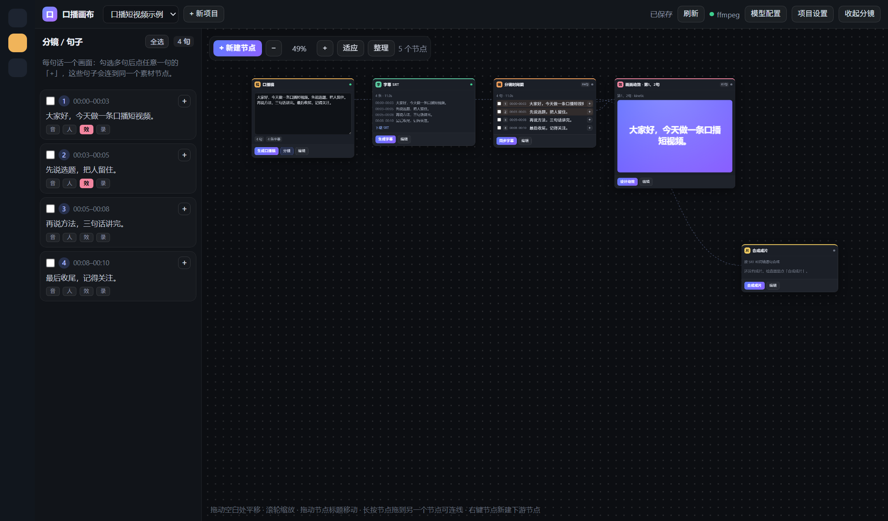
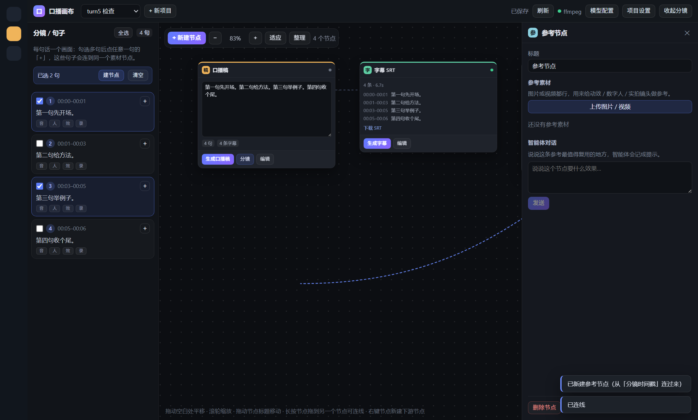
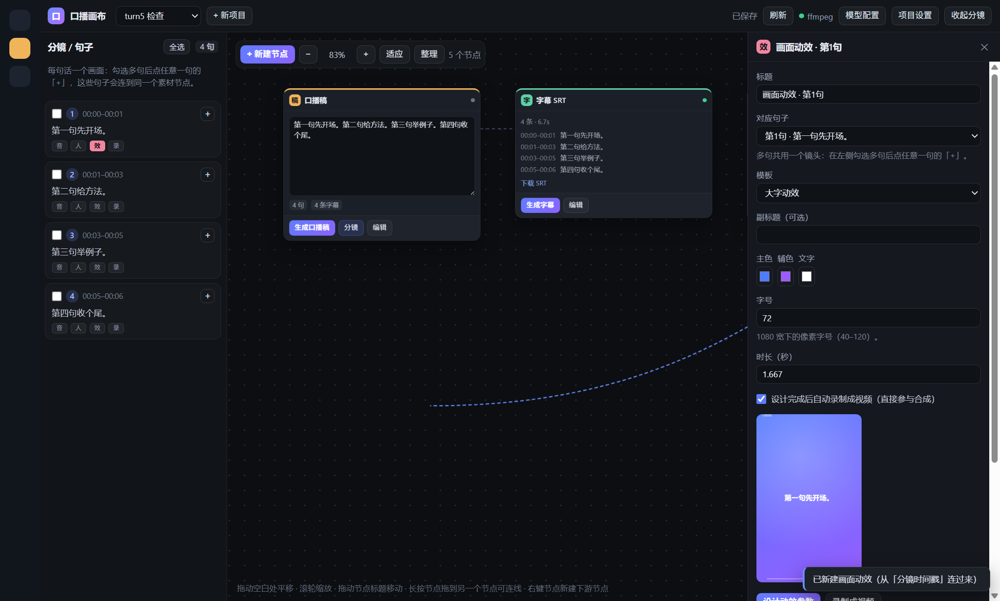

# 口播画布（dsh-oral-canvas）

一条口播短视频从文字到成片的**无限画布**工作台。每个节点就是一个环节，每个环节可以按「第几句话」单独建节点、单独生成素材，最后按 SRT 时间戳把每句的画面对上字幕和配音合成整片。

```
口播稿 → 数字人音频 → 字幕 SRT → 分镜时间戳 → 数字人视频 / 代码动效 / 软件实录 → 合成成片
```

「分镜时间戳」是字幕 SRT 衍生出来的节点：一个节点里逐句列出时间戳和字幕，可以直接在上面改字幕（改完同步回口播稿和合成字幕），后面每种素材都从这个节点的对应行连线过去。





## 安装

作为 DSH 插件安装（host 半负责生成/合成，client 半是画布面板）：

```bash
# 方式一：从本仓库本地目录安装（推荐）
# 在 DSH 里让 Agent 执行：plugin_manager install_bundle，目标填本仓库目录的绝对路径
# 或者手动：把下面的路径加进 ~/.dsh/profiles/<profile>/package.json 的 dependencies + dsh.profile.bundles

# 方式二：npm 从 git 安装
npm install github:<你的用户名>/dsh-oral-canvas
```

依赖：DSH 0.2.x（client slots `main` / `sidebar.panellist`）、Node 20+、可选 ffmpeg（合成与字幕烧录）。

## 打开方式

1. 装好后**刷新 DSH 页面**。
2. 左侧图标栏点「口」图标（口播画布），中间面板就是画布。
3. 想让它每次打开自动进入画布：点画布左上角工具条的 **固定**（默认已固定，再点一次取消）。

## 分镜时间戳（逐句连线）

- 第一次生成字幕（或打开已有时间轴的项目）时，画布会在 SRT 后面自动补一个「分镜时间戳」节点，并把 口播稿 → 字幕 SRT → 分镜时间戳 连好。
- 节点里每行是「勾选框 · 序号 · 起止时间 · 字幕」；点字幕就能改，改完会同时写回 `srt.cues`、`script.sentences` 和口播稿卡片，左边分镜和合成字幕一起更新。
- 每行前面的方框可多选，节点底部有「已选 N 句 · 建节点 / 清空」，勾几句后建节点 = 一个镜头 + 每句一条线；每行右侧的 `+` 以该句为主、连同已勾的句子一起建。
- 某几句已经有素材时，对应行会高亮；点「同步字幕」会把空的字幕行用口播稿补齐并重写 SRT 文件。

## 画布操作

- **长按卡片（约 0.3 秒）后拖动**：拉出一根虚线，松在手边另一个节点上就建立连线（连到分镜时间戳时会记录起始句）。
- **右键卡片**：弹出「从这里新建节点」，选类型即在右侧生成一个已连好的下游节点（参考节点、合成成片都在列表里）。
- 新建/连线后的节点会自动居中到视野里；顶部「适应」看全流水线，「整理」按「句子 × 环节」重排。

## 每句话一个画面

- 左栏「分镜 / 句子」按句号 / 问号 / 感叹号自动分句，每句显示它在 SRT 里的起止时间。
- 改稿：直接在「口播稿」卡片里编辑（或点「编辑」进检查器），然后按卡片上的 **分镜** 按钮——正文会重新按标点切句、左栏立刻刷新；句子数变了旧字幕时间轴会一并清空（卡片提示「字幕需重排」），到「字幕 SRT」点一次「生成字幕」即可。
- 点句子右上角的 `+`，菜单会锁定这一句，直接选「数字人音频 / 数字人视频 / 画面动效 / 软件实录」，建出来的节点就绑在这句上。
- 批量：每句前面的勾选框可多选（标题旁有「全选 / 取消全选」，选中有「已选 N 句 · 建节点 / 清空」条），选好几句后点「建节点」→ 选类型：
  - 数字人视频 / 画面动效 / 软件实录 → **共用一个镜头**：只建 1 个节点，从分镜时间戳对应的每一行各拉一条线过去，一眼能看出这几句用的是同一段素材；
  - 数字人音频 → 每句一个节点（配音本来就是逐句生成的），默认建完按顺序生成。
- 也可以勾几句后直接点其中一句的 `+`，效果同上（选中的句子会一起连到新节点）。
- 句子下方的 `音 人 效 录` 小药丸可以直接补建，亮起表示这句已经有该类节点。
- 「合成成片」按 SRT 的每条字幕找覆盖这句的素材，按 `合成优先级` 取（默认 数字人视频 → 画面动效 → 软件实录），用 `-stream_loop` 裁/补到这条字幕的时长——一个多句镜头会被它覆盖的每一句重复使用；没有素材的句子会按空镜渲染，节点日志会写「空镜 N 句」。

## 节点与生成

| 节点 | 生成方式 | 产物 |
| --- | --- | --- |
| 口播稿 | 文本模型（或手写正文直接应用） | `project.script.sentences`，自动切句 |
| 数字人音频 | OpenAI 兼容 `/audio/speech`，支持整段或逐句 | mp3 + 时长（写入素材） |
| 字幕 SRT | 自动对齐 / Whisper 识别整段音频 / 粘贴现成 SRT | `subtitles.srt` + cue 列表 |
| 分镜时间戳 | 由 cue 列表派生；「同步字幕」按口播稿补空行并重写 SRT | 逐句时间戳节点（可改字幕） |
| 数字人视频 | 本机命令模板 或 HTTP 视频接口（可轮询 statusUrl） | 视频素材 |
| 画面动效 | 动效 LLM 生成参数 → 浏览器 canvas 渲染（5 套模板）→ MediaRecorder 录成 webm | 视频素材（默认设计完自动录制） |
| 软件实录 | 上传视频 / 填本机绝对路径导入 | 视频素材 |
| 参考节点 | 上传图片或视频，作为这个镜头的参考素材 | 参考素材（不参与合成，供智能体/生成使用） |
| 合成成片 | ffmpeg：逐句裁切 → concat → 音频按 cue 起点 adelay/amix → ASS 烧字幕 | `files/exports/*.mp4` |

## 智能体对话

画面动效 / 数字人视频 / 软件实录 / 参考节点的检查器里都有「智能体对话」：直接用中文说要求（标题、配色、节奏、景别、拍摄要点…），`POST /oral-canvas/api/projects/:id/nodes/:nodeId/chat` 会把节点当前参数、覆盖的句子和时间戳一起交给 LLM，模型回一段说明 + 一段 JSON 参数补丁，补丁直接合并进 `node.params`；动效节点改完参数会自动按新参数重新录制成视频（可在检查器里关掉）。对话历史存在 `node.chat`（最多 40 条）。

SRT 自动对齐规则：

- 有逐句音频 → 直接用每句音频时长；
- 只有整段音频 → 用总时长按字数分配（约 4.2 字/秒，每句至少 1.2s）；
- 既没有音频也没有 `totalDuration` → 按字数估算总长，先把时间轴排出来，等音频生成后再点一次「生成字幕」即可精确对齐。

## 模型配置

顶部「模型配置」维护五类能力：文本 / TTS / ASR / 视频 / 动效，每类可加多条（不同供应商、不同 key），节点检查器里按能力选具体模型。API Key 只保存在本机 `~/.dsh/oral-canvas/models.json`，接口返回时会打码；HTTP 视频接口和本机命令都支持。

命令模板占位符：`{text}` `{sentence}` `{duration}` `{out}` `{width}` `{height}` `{audio}`；命令通过 `cmd /c` 执行（Windows 路径请用正斜杠或双反斜杠）。

## 数据与接口

- 数据目录：`~/.dsh/oral-canvas/`（`projects/*.json`、`files/<projectId>/…`、`files/exports/*.mp4`、`models.json`）。插件 config 支持 `dataDir`（换存储位置）和 `ffmpeg`（ffmpeg 可执行文件路径）。
- HTTP 前缀：`/oral-canvas`，常用接口：
  - `GET /oral-canvas/api/bootstrap`
  - `GET/POST /oral-canvas/api/projects`、`GET/PUT/DELETE /oral-canvas/api/projects/:id`
  - `POST /oral-canvas/api/projects/:id/nodes/:nodeId/generate` → `{ job }`，`GET /oral-canvas/api/jobs/:id`
  - `POST /oral-canvas/api/projects/:id/nodes/:nodeId/chat`（`{ message }` → `{ reply, patch, node }`）
  - `PUT /oral-canvas/api/upload?projectId&nodeId&name`（headers：`x-file-type`、`x-duration`）
  - `GET /oral-canvas/api/projects/:id/srt`（下载 SRT）、`GET/PUT /oral-canvas/api/models`
  - `GET /oral-canvas/files/...`（素材，支持 Range）

## 已知限制

- 画面动效的「录制成视频」依赖浏览器的 `MediaRecorder`，录制时请让页面保持可见；录制中不要切换项目。
- 字幕烧录用 ASS（`PlayResX/Y` 跟项目分辨率一致），字号默认取画面短边的 5.2%、底边距 9.4%，可在项目设置里传 `subtitle` 覆盖。
- 合成依赖 ffmpeg：优先读取插件 config 的 `ffmpeg`，其次环境变量 `FFMPEG_PATH`，再次 PATH，最后回退本机 `D:\ffmpeg-8.0.1-full_build\…\bin\ffmpeg.exe`。
